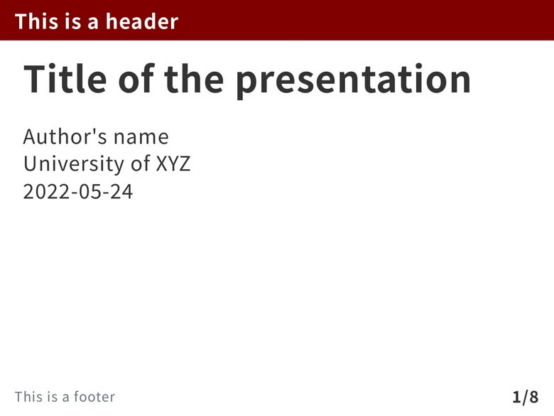
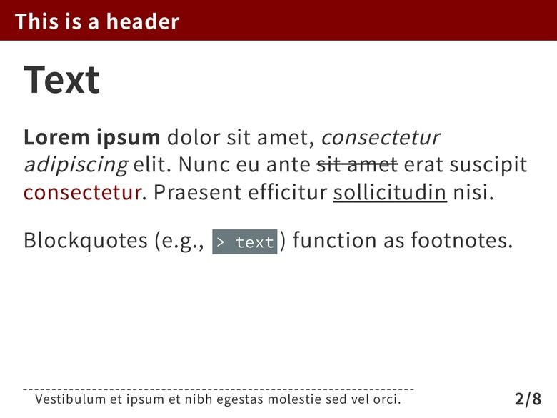
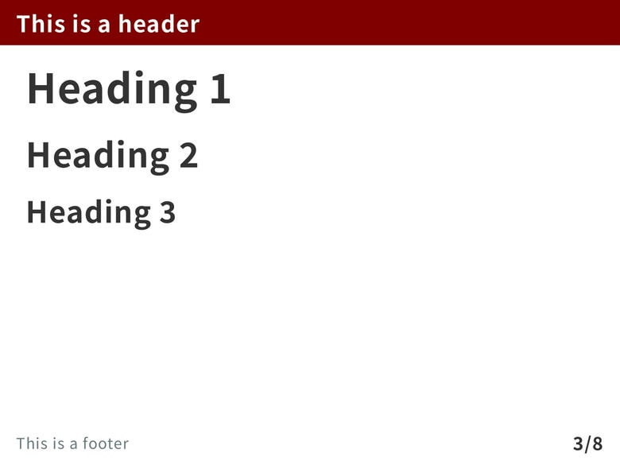
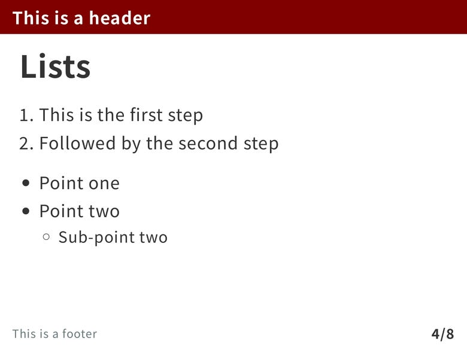
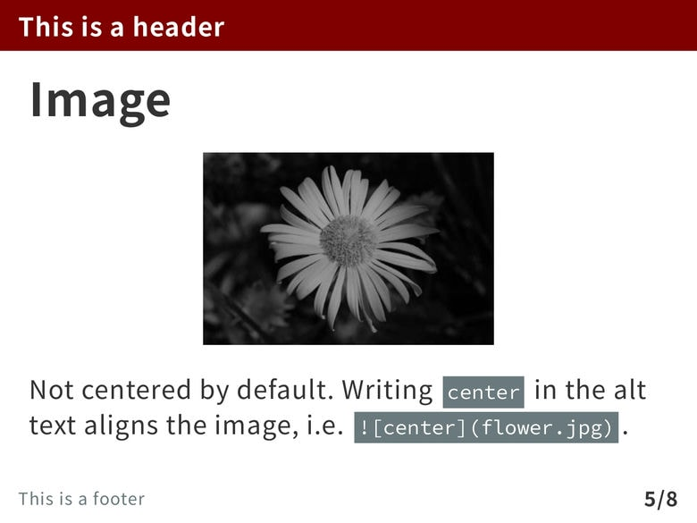
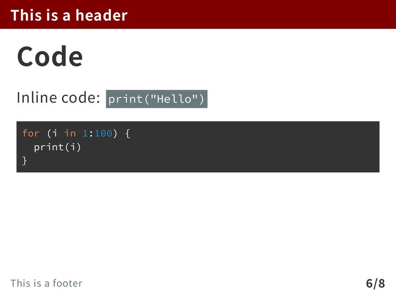
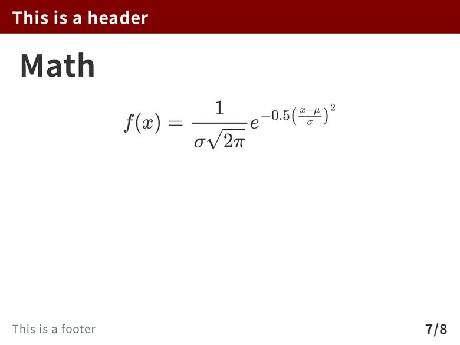
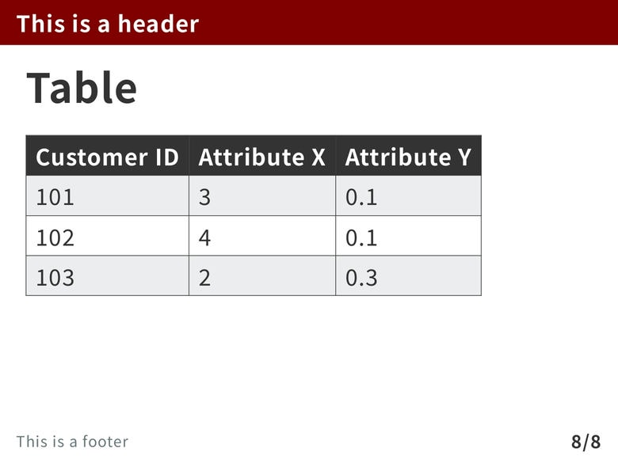

The `academic` theme by [kaisugi](https://github.com/kaisugi) features a clean design with a maroon ribbon on top. Additionally, it leverages the Markdown blockquote syntax (e.g., `> text`) to enable footnotes. The theme imports [Noto Sans](https://fonts.google.com/noto/specimen/Noto+Sans+JP/about) with support for Japanese and [Source Code Pro](https://github.com/adobe-fonts/source-code-pro).

If you like the `academic` theme and wish to show support to the author(s), please consider [starring the theme's GitHub repository](https://github.com/kaisugi/marp-theme-academic/)!

# Screenshots

















# Custom classes and keywords

``

- By default, images are left-aligned.
- The `center` keywords centers the image.

Blockquotes (i.e., `> text`) are treated as footnotes.


::: {.callout-note collapse="true" appearance="simple"}
## Markdown template

``````md
---
marp: true
paginate: true
theme: academic
size: 4:3
header: This is a header
footer: This is a footer
title: Testing MD file
---

# Title of the presentation

Author's name
University of XYZ
2023-05-13

---

<!-- _footer: "" -->

# Text

**Lorem ipsum** dolor sit amet, *consectetur adipiscing* elit. Nunc eu ante ~~sit amet~~ erat suscipit <mark>consectetur</mark>. Praesent efficitur <u>sollicitudin</u> nisi.

Blockquotes (e.g., `> text`) function as footnostes.

> Vestibulum et ipsum et nibh egestas molestie sed vel orci.

---

# Heading 1

## Heading 2

### Heading 3

---

# Lists

1. This is the first step
2. Followed by the second step

- Point one
- Point two
  - Sub-point two

---

# Image

An image of a flower in our garden.


Not centered by default. Writing `center` in the alt text aligns the image, i.e. ``.

---

# Code

Inline code: `print("Hello")`

Block of code:

```r
for (i in 1:100) {
  print(i)
} 
```

---

# Math

$$
f(x) = \frac{1}{\sigma \sqrt{2\pi}} e^{-0.5 \left( \frac{x-\mu}{\sigma} \right)^2}
$$

---

# Table

| Customer ID | Attribute X | Attribute Y |
| ----------- | ----------- | ----------- |
| 101         | 3           | 0.1         |
| 102         | 4           | 0.1         |
| 103         | 2           | 0.3         |

``````
:::


# Privacy notice

Please, be aware that by using this CSS theme you import fonts from the Google Fonts service. Refer to their [Privacy FAQ](https://developers.google.com/fonts/faq/privacy) for more information about using their service.

# License

This theme is licensed under the [MIT License](https://github.com/kaisugi/marp-theme-academic/blob/main/LICENSE).