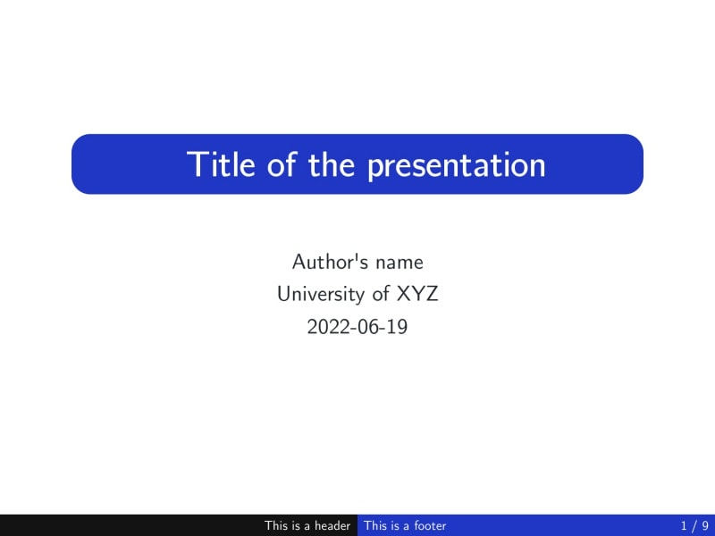
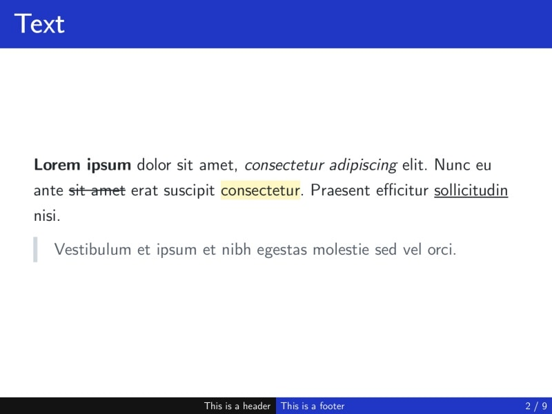
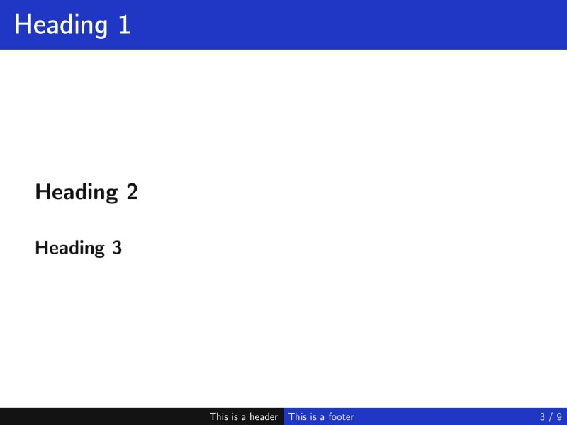
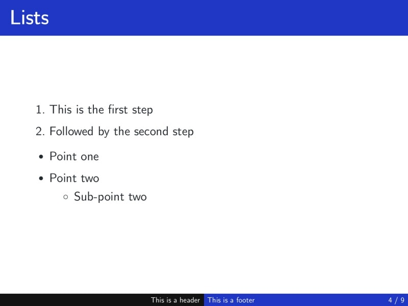
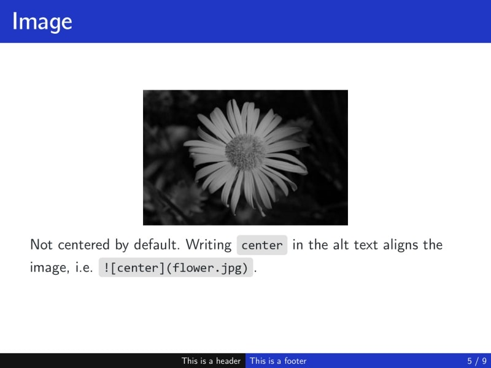
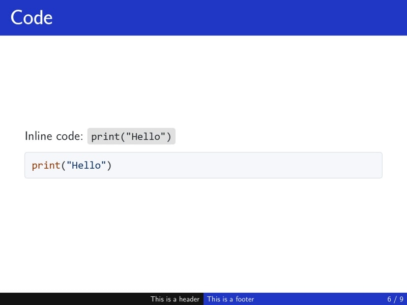
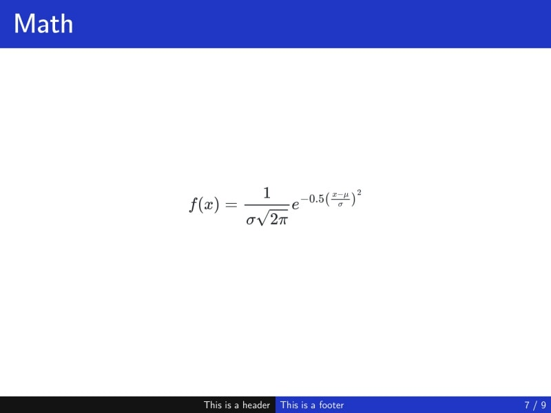
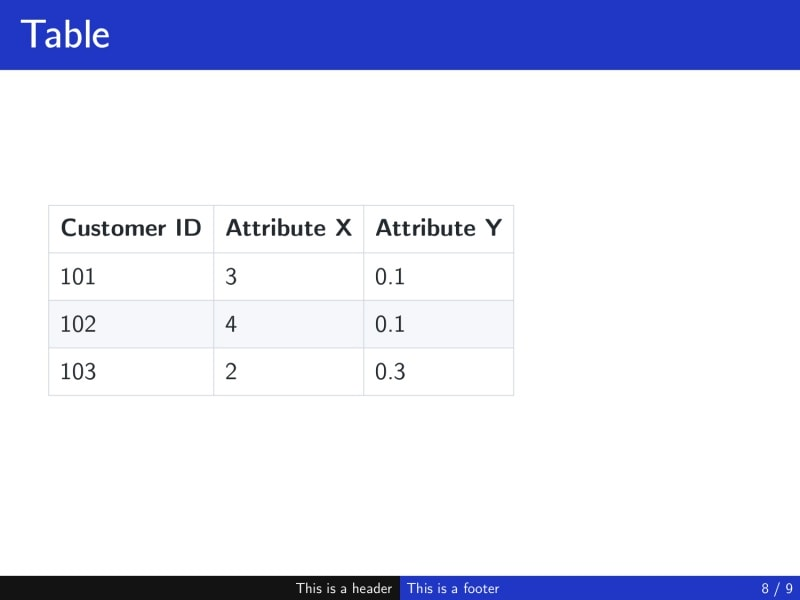
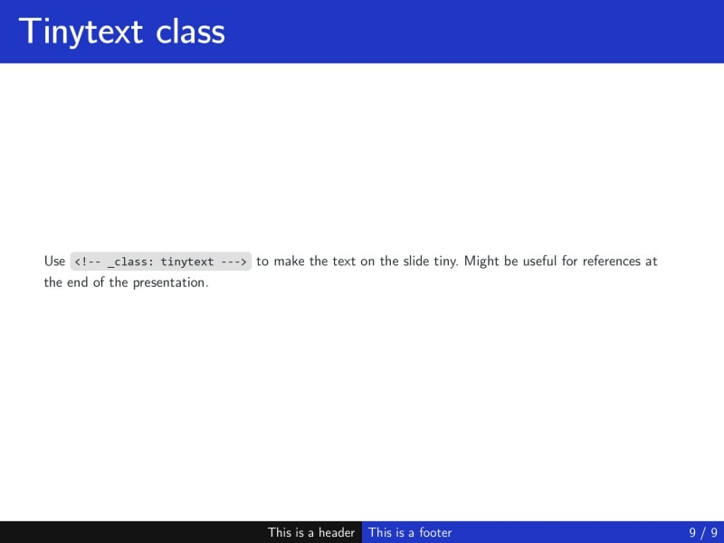

The `beam` theme by [rnd195](https://github.com/rnd195/) is inspired by the look of LaTeX's `beamer` class. As such, it is intended to be used with the [Computer Modern Unicode font family](https://ctan.org/pkg/cm-unicode?lang=en). It also provides support for a title page. To change the default colors from blue to anything else, please, follow the guide in the [GitHub repository](https://github.com/rnd195/my-marp-themes/blob/live/how-to/beam_custom.md) of the theme.

# Screenshots



- `<!-- _class: title -->` needs to be specified for the first slide to look like this. See **Markdown template** below



















# Custom classes and keywords

`<!-- _class: title -->`

- Changes the layout of the slide to a title page.
- **The first Heading 1 will be styled as the title.**
- Make sure to include the underscore "_" so that your whole presentation is not made up of title pages.
- The title should be no more than 2 lines long, otherwise, it spills over other text.

`<!-- _class: tinytext -->`

- Makes most text on the slide much smaller.
- Might be useful for references.

``

- By default, images are left-aligned.
- The `center` keywords centers the image.


::: {.callout-note collapse="true" appearance="simple"}
## Markdown template

``````md
---
marp: true
paginate: true
theme: beam
size: 4:3
header: This is a header
footer: This is a footer
title: Testing MD file
---

<!-- _class: title -->
# Title of the presentation

Author's name
University of XYZ
2023-05-13

---

# Text

**Lorem ipsum** dolor sit amet, *consectetur adipiscing* elit. Nunc eu ante ~~sit amet~~ erat suscipit <mark>consectetur</mark>. Praesent efficitur <u>sollicitudin</u> nisi.

> Vestibulum et ipsum et nibh egestas molestie sed vel orci.

---

# Heading 1

## Heading 2

### Heading 3

---

# Lists

1. This is the first step
2. Followed by the second step

- Point one
- Point two
  - Sub-point two

---

# Image

An image of a flower in our garden.


Not centered by default. Writing `center` in the alt text aligns the image, i.e. ``.

---

# Code

Inline code: `print("Hello")`

Block of code:

```r
for (i in 1:100) {
  print(i)
} 
```

---

# Math

$$
f(x) = \frac{1}{\sigma \sqrt{2\pi}} e^{-0.5 \left( \frac{x-\mu}{\sigma} \right)^2}
$$

---

# Table

| Customer ID | Attribute X | Attribute Y |
| ----------- | ----------- | ----------- |
| 101         | 3           | 0.1         |
| 102         | 4           | 0.1         |
| 103         | 2           | 0.3         |

---
<!-- _class: tinytext --->
# Tinytext class

Use `<!-- _class: tinytext --->` to make the text on the slide tiny. Might be useful for references at the end of the presentation.

``````
:::


# License

The `beamer`-inspired `beam` theme is licensed under [GNU GPLv3](https://github.com/rnd195/my-marp-themes/blob/live/licenses/LICENSE_beam).
