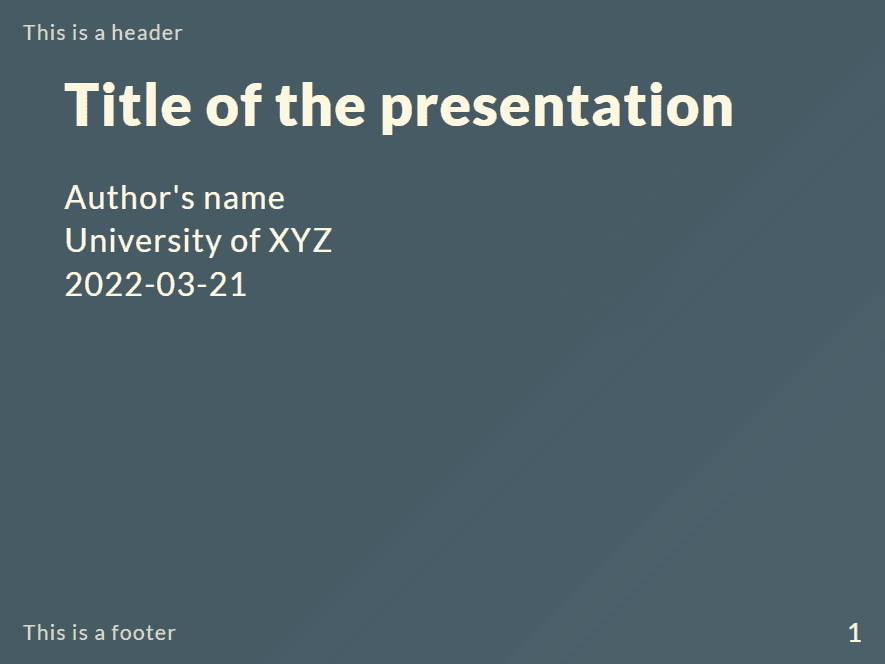
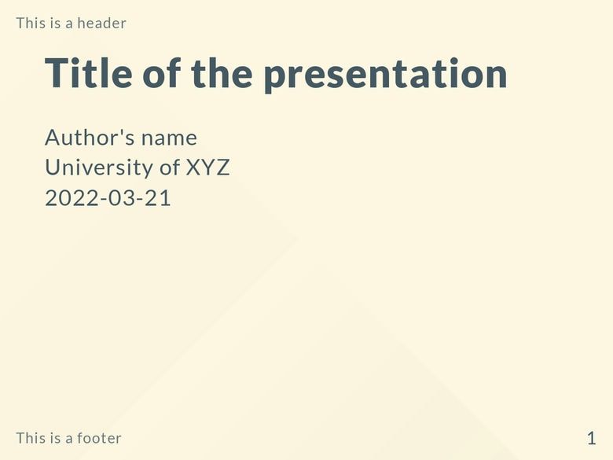
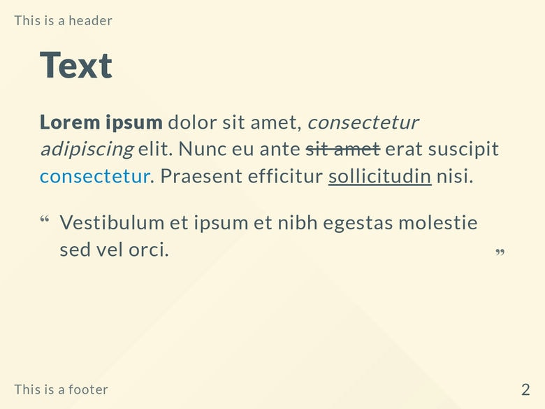
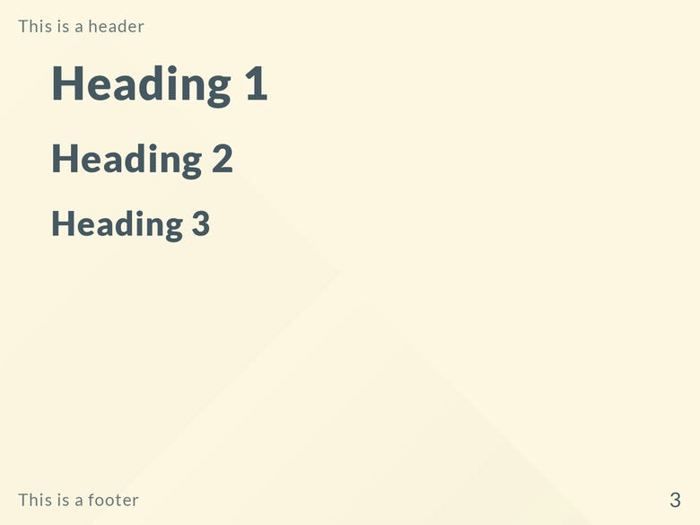
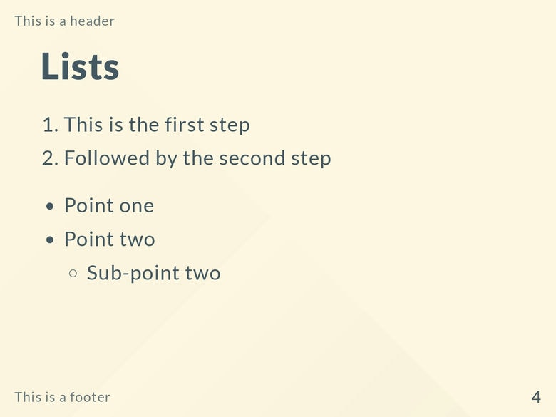
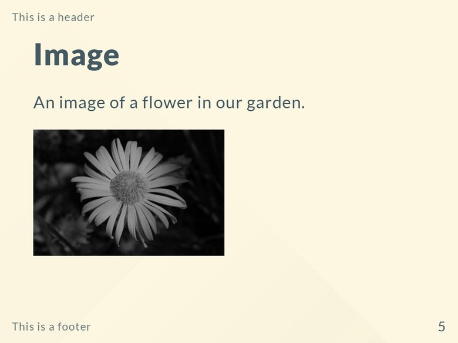
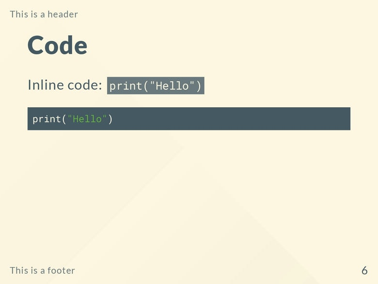
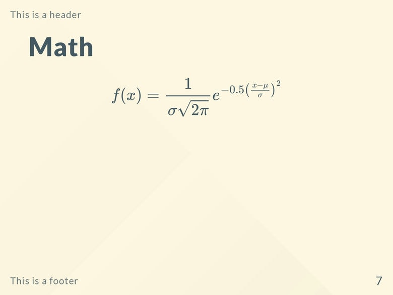
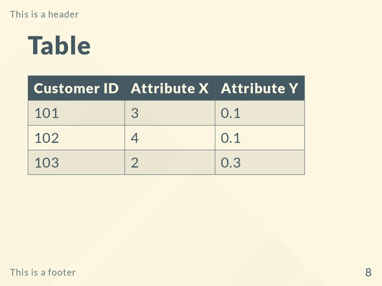

Gaia by the [marp-team](https://github.com/marp-team/) is a built-in theme in Marp featuring a minimalistic color palette of [*cornsilk*](https://www.color-name.com/hex/fff8e1) (light yellow) and [*deep space sparkle*](https://www.color-name.com/hex/455a64) (greenish grey).

If you like the `gaia` theme and wish to show support to the author(s), please consider [starring the theme's GitHub repository](https://github.com/marp-team/marp)!

# Screenshots

## `class: invert`



## `class: default`

















# Custom classes and keywords

`<!-- _class: invert -->`

- Color-inverted variant of the theme.

`<!-- _class: lead -->`

- Centered text


::: {.callout-note collapse="true" appearance="simple"}
## Markdown template

``````md
---
marp: true
paginate: true
theme: gaia
size: 4:3
header: This is a header
footer: This is a footer
title: Testing MD file
---

# Title of the presentation

Author's name
University of XYZ
2023-05-13

---

# Text

**Lorem ipsum** dolor sit amet, *consectetur adipiscing* elit. Nunc eu ante ~~sit amet~~ erat suscipit <mark>consectetur</mark>. Praesent efficitur <u>sollicitudin</u> nisi.

> Vestibulum et ipsum et nibh egestas molestie sed vel orci.

---

# Heading 1

## Heading 2

### Heading 3

---

# Lists

1. This is the first step
2. Followed by the second step

- Point one
- Point two
  - Sub-point two

---

# Image

An image of a flower in our garden.


---

# Code

Inline code: `print("Hello")`

Block of code:

```r
for (i in 1:100) {
  print(i)
} 
```

---

# Math

$$
f(x) = \frac{1}{\sigma \sqrt{2\pi}} e^{-0.5 \left( \frac{x-\mu}{\sigma} \right)^2}
$$

---

# Table

| Customer ID | Attribute X | Attribute Y |
| ----------- | ----------- | ----------- |
| 101         | 3           | 0.1         |
| 102         | 4           | 0.1         |
| 103         | 2           | 0.3         |

---

<!-- _class: lead -->

# Class lead

Text

---

<!-- _class: invert -->

# Class invert

Text
``````
:::


# License

This theme is licensed under the [MIT License](https://github.com/marp-team/marp/blob/main/LICENSE).