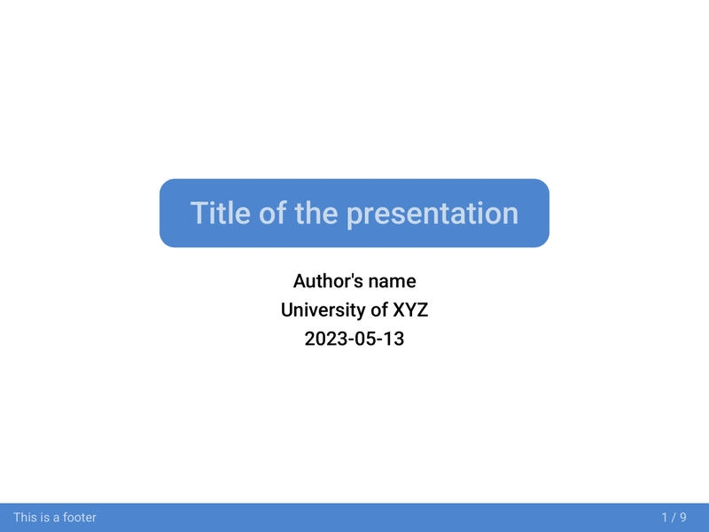
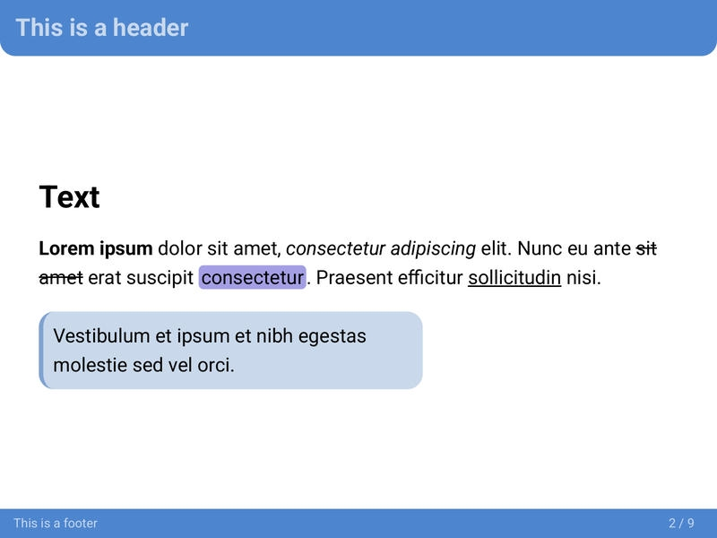
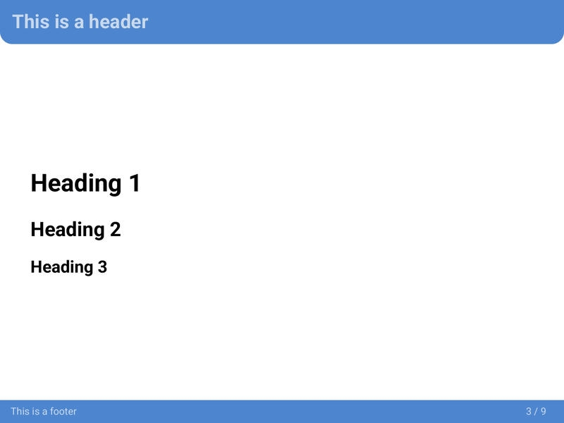
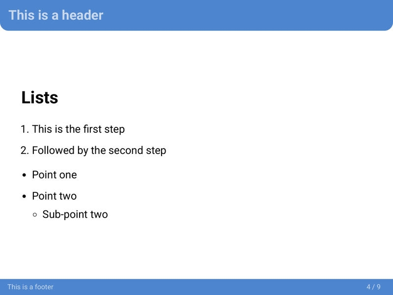
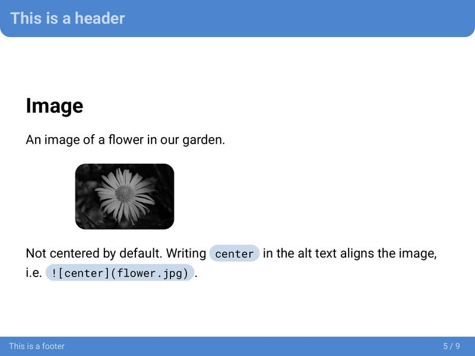
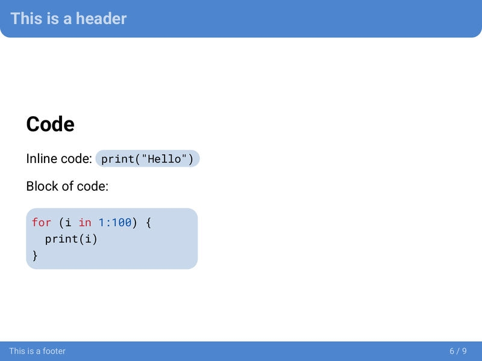
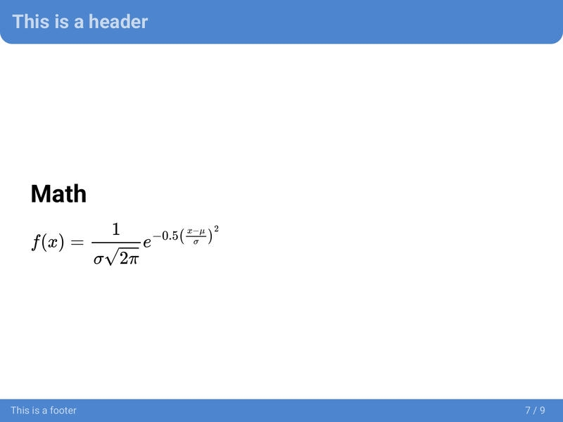
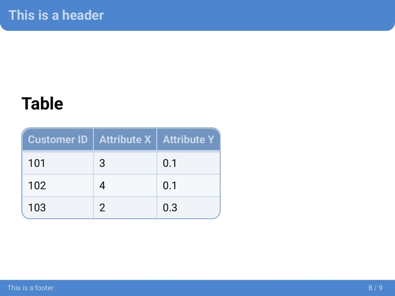
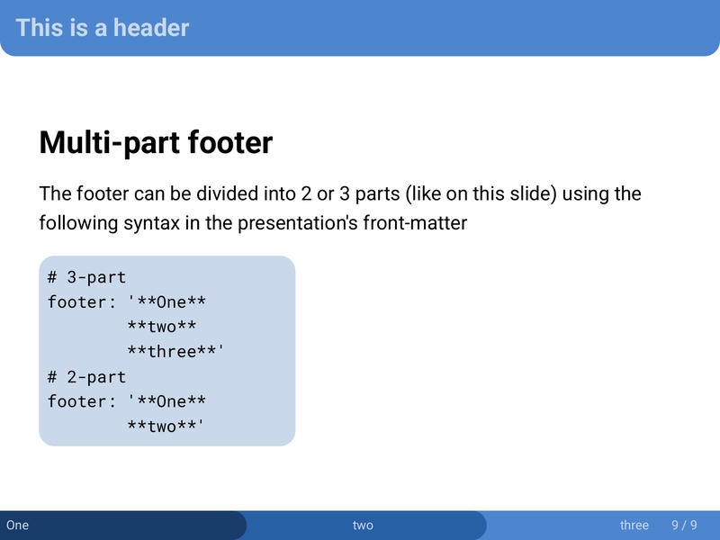

The `neobeam` theme by [mikael-ros](https://github.com/mikael-ros/) is a modern take on the LaTeX beamer. It contains several color variants and custom syntax for features such as a title page or a three-part footer.

If you like the `neobeam` theme and wish to show support to the author(s), please consider [starring the theme's GitHub repository](https://github.com/mikael-ros/neobeam)!

# Screenshots



- `<!-- _class: title -->` needs to be specified for the first slide to look like this. Here is an example of what that could look like

```
---
marp: true
theme: beam
---
<!-- _class: title -->
<!-- _header: "" -->
# Title of the presentation
Author's name
University of XYZ
2023-05-13
```


















## Theme variants

Click each theme name to get its CSS file. Please note that the base `neobeam` theme is required for these variants to work.

::: {layout-ncol=2}
](neobeam.assets/neobeam-beamer.jpg)

](neobeam.assets/neobeam-csek.jpg)

](neobeam.assets/neobeam-dsek.jpg)

](neobeam.assets/neobeam-ecobeam.jpg)

](neobeam.assets/neobeam-embracket.jpg)

](neobeam.assets/neobeam-lund.jpg)

](neobeam.assets/neobeam-neonbeam.jpg) 

](neobeam.assets/neobeam-oldenbeam.jpg) 

:::

# Custom classes and keywords

`<!-- _class: title -->`

- Changes the layout of the slide to a title page.
- The first Heading 1 will be styled as the title.
- Make sure to include the underscore “_” so that your whole presentation is not made up of title pages.
- Use `<!-- _header: "" -->` to disable the header on the title page.

`Multi-part footer`

The footer can be divided into 2 or 3 parts using the following syntax in the presentation's front-matter

```
# 3-part
footer: '**One**
        **two**
        **three**'
# 2-part
footer: '**One**
        **two**'
```

Or for a particular slide

```
<!-- _footer: '**One** **two** **three**' -->
```

``

- By default, images are left-aligned.
- The `center` keywords centers the image.


::: {.callout-note collapse="true" appearance="simple"}
## Markdown template

``````md
---
marp: true
paginate: true
theme: neobeam
size: 4:3
header: This is a header
footer: This is a footer
title: Testing MD file
---

<!-- _header: "" -->
<!-- _class: title -->

# Title of the presentation

Author's name
University of XYZ
2023-05-13

---

# Text

**Lorem ipsum** dolor sit amet, *consectetur adipiscing* elit. Nunc eu ante ~~sit amet~~ erat suscipit <mark>consectetur</mark>. Praesent efficitur <u>sollicitudin</u> nisi.

> Vestibulum et ipsum et nibh egestas molestie sed vel orci.

---

# Heading 1

## Heading 2

### Heading 3

---

# Lists

1. This is the first step
2. Followed by the second step

- Point one
- Point two
  - Sub-point two

---

# Image

An image of a flower in our garden.


Not centered by default. Writing `center` in the alt text aligns the image, i.e. ``.

---

# Code

Inline code: `print("Hello")`

Block of code:

```r
for (i in 1:100) {
  print(i)
} 
```

---

# Math

$$
f(x) = \frac{1}{\sigma \sqrt{2\pi}} e^{-0.5 \left( \frac{x-\mu}{\sigma} \right)^2}
$$

---

# Table

| Customer ID | Attribute X | Attribute Y |
| ----------- | ----------- | ----------- |
| 101         | 3           | 0.1         |
| 102         | 4           | 0.1         |
| 103         | 2           | 0.3         |


---

<!-- _footer: '**One** **two** **three**' -->

# Multi-part footer

The footer can be divided into 2 or 3 parts (like on this slide) using the following syntax in the presentation's front matter or as a comment.

```
# 3 part
footer: '**One**
        **two**
        **three**'
# 2 part
footer: '**One**
        **two**'
```
``````
:::


# Privacy notice

Please, be aware that by using this CSS theme you import fonts from the Google Fonts service. Refer to their [Privacy FAQ](https://developers.google.com/fonts/faq/privacy) for more information about using their service.

# License

This theme is licensed under the [MIT License](https://github.com/mikael-ros/neobeam/blob/main/LICENSE).